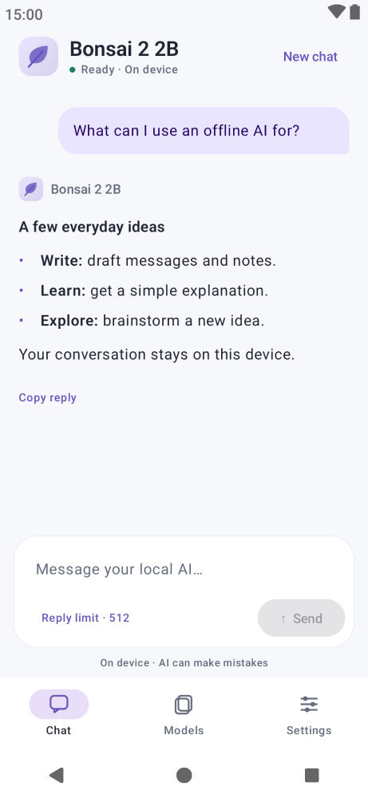
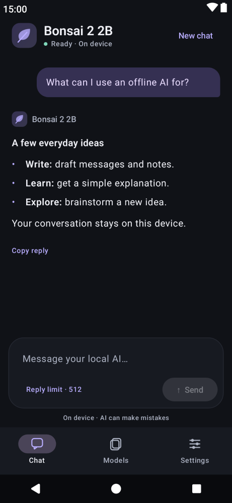
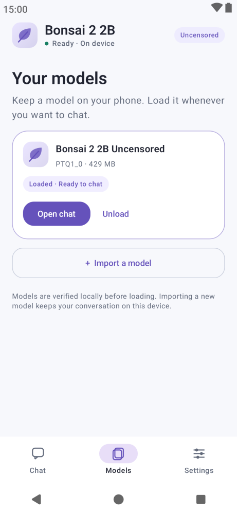
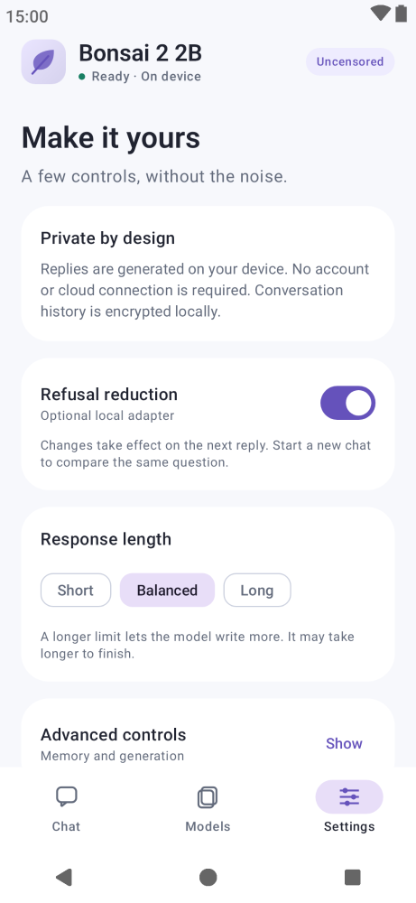

# Bonsai 2 2B Uncensored for Android

Experimental offline Android chat with PrismML's **Bonsai 2 2B** and AtomicChat's optional refusal-reduction LoRA. The official model weights remain unchanged. The app runs inference directly through JNI on the CPU and requests no Internet permission.

[Download the preview APK](https://github.com/gdalabs/bonsai-2-2b-uncensored-android/releases/tag/v0.1.2-uncensored-preview) · [Build from source](BUILD.md) · [Validation](VALIDATION.md)

## UI previews

Actual Compose UI rendered with a fixed **English** sample question and answer. These are layout previews, not physical-device screenshots or model-quality evidence. [Capture details and reproduction](tools/ui-preview).

  
  

  
  

Markdown replies display headings, bold, lists, tables, links and code blocks. Reasoning, when provided, is collapsed separately from the final answer. Code and reply text can be copied. System light/dark mode, model management and generation controls share the same interface.

## Try it

1. Install the model-bundled **ARM64** APK on Android 9 or newer.
2. Wait for bundled-model verification, then tap **Load model & start** on Chat.
3. Send a question. In Settings, switch **Refusal reduction** on or off. Use **New chat** before comparing the same prompt in both modes.

The preview uses `org.meshmind.app.uncensored`, so it can be installed alongside the original MeshMind and Bonsai Local apps. APK and private model copy both occupy storage. This is a non-debuggable release APK signed with the existing Android debug identity for preview updates. Production signing and real-device validation of this preview are pending.

## Models

| Component | Pinned source | Bytes |
| --- | --- | ---: |
| Base | [PrismML Bonsai 2 2B PTQ1_0](https://huggingface.co/prism-ml/Ternary-Bonsai-2-2B-gguf/tree/683f7be2629342a50987627b40881e54761a2430) | 429,183,456 |
| Adapter | [AtomicChat 2B refusal-reduction LoRA](https://huggingface.co/AtomicChat/Ternary-Bonsai-2-2B-Uncensored-LoRA-GGUF/tree/3ddae94b35c44b7a07e927aea82618ce7d447eef) | 1,187,136 |

Checksums and exact-base binding are enforced during packaging and loading. The adapter is applied at inference time at strength 1; disabling it removes the adapter from the context. The ternary base is never requantized or overwritten. Only the exact pinned PTQ1_0 base is supported in this preview. Model provisioning occurs on the build host or by local file transfer; the app never downloads weights.

## Scope and evidence

- Text chat, streaming, cancellation, context reset and encrypted local chat history.
- No network permission, telemetry, inference server or action-execution tools. Backgrounding stops generation.
- Focused Chat, Models and Settings screens; no messenger component is included.
- JVM tests and real host inference passed. This new adapter APK still needs an actual phone test. Reduced refusals do not establish correctness or broad capability retention. Effectiveness outside the publisher's evaluated English prompts is unmeasured.

The `Uncensored` label refers to the experimental refusal-reduction adapter, and does not promise that every request will receive an answer. See the [publisher's evaluation and limitations](https://huggingface.co/AtomicChat/Ternary-Bonsai-2-2B-Uncensored-LoRA-GGUF).

## License

Application source: **GPL-3.0-only**. Official model and AtomicChat adapter: **Apache-2.0**. Runtime libraries retain their own licenses. Full texts, copyright notices and a runtime component index are included under [docs/notices](docs/notices) and in the APK. See [LICENSES.md](LICENSES.md).
